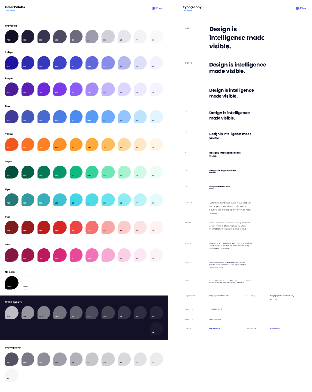

# Dlex — Marketing Components & Design System (25-Amaliy Ish)

Figma dizaynining yuqori aniqlikdagi (**Pixel-Perfect**) to'liq, zamonaviy, interaktiv va to'liq moslashuvchan (fully responsive) dizayn tizimi platformasi: **Dlex — Design System: Color Palette & Typography (node-id: 204:0)**.

[-F24E1E?logo=figma&logoColor=white)](https://www.figma.com/file/MQhHg9TqNJspRKL18hPyLC/Dlex?type=design&node-id=204%3A0&mode=design&t=xINnHQI1ViedHyVh-1)
[](https://developer.mozilla.org/en-US/docs/Web/HTML)
[](https://developer.mozilla.org/en-US/docs/Web/CSS)
[](https://developer.mozilla.org/en-US/docs/Web/JavaScript)
[](https://developer.mozilla.org/en-US/docs/Learn/CSS/CSS_layout/Responsive_Design)
[](https://vercel.com/)

---

## 📸 Figma Dizayn Ko'rinishi



---

## 📌 Loyiha Haqida

Ushbu loyiha Figma platformasidagi mashhur **Dlex (Marketing Components for Figma)** dizaynining **Color Palette** hamda **Typography** tizimi (node-id: `204:0`) asosida 100% aniqlik bilan ishlab chiqilgan. Loyiha professional veb-platformalar, landing sahifalar va SaaS ilovalari uchun mukammal poydevor bo'lib xizmat qiluvchi to'liq dizayn tizimini (Design System) ifodalaydi.

- **Figma Manzili**: [Dlex — node-id: 204:0](https://www.figma.com/file/MQhHg9TqNJspRKL18hPyLC/Dlex?type=design&node-id=204%3A0&mode=design&t=xINnHQI1ViedHyVh-1)
- **Topshiriq**: 25-Amaliy Ish
- **GitHub Repozitoriyasi**: [https://github.com/soxibs48-eng/amaliy25](https://github.com/soxibs48-eng/amaliy25)

---

## ✨ Asosiy Imkoniyatlar va Funksionallik

1. **Pixel-Perfect Figma Specimen (node-id: 204:0)**:
   - Chap ustunda: **Color Palette** — barcha 10 ta asosiy rang oilasi (har birida 10 tadan soya: 900, 800, 700, 600, 500, 400, 300, 200, 100, 50), No Color (Black & White), to'q fondagi White-Opacity konteyneri hamda Gray-Opacity shaffofliklar to'plami.
   - O'ng ustunda: **Typography** — Plus Jakarta Sans shrifti asosidagi Display 1, Display 2, H1–H6, Body-20 dan Body-12 gacha bo'lgan matn masshtabi, Caption hamda Button-L, Button-M va havola (Link) namunalari.
   - Dlex-ning o'ziga xos imzosi bo'lgan **tomchi / barg (teardrop) shaklidagi swatches** (`border-radius: 50% 50% 0 50%`) va ichki vazn raqamlari aniq aks ettirilgan.

2. **12 ta Rang Oilasi va 102 ta Rang Tokenlari**:
   - `Grayscale`: `#121127` dan `#f9f9fb` gacha.
   - `Indigo` (Asosiy brend aksenti): `#1e149d` dan `#f2f3ff` gacha.
   - `Purple` (Ijodiy aksentlar): `#4c1d95` dan `#f5f3ff` gacha.
   - `Blue` (Axborot holatlari): `#3e399b` dan `#e1f5ff` gacha.
   - `Yellow / Orange` (Ogohlantirish va energiya): `#f25722` dan `#fff4e6` gacha.
   - `Green` (Muvaffaqiyat va tasdiq): `#064e3b` dan `#ecfdf5` gacha.
   - `Cyan` (Metrika va texnologiya): `#2a7576` dan `#e4fafc` gacha.
   - `Red` (Xatolik va bekor qilish): `#7f1d1d` dan `#fef2f2` gacha.
   - `Pink` (Ijtimoiy aksentlar): `#831843` dan `#fdf2f8` gacha.
   - `No Color`: Black (`#000000`) va White (`#ffffff`).
   - `White-Opacity` (To'q fonda): 90%, 80%, 70%, 60%, 50%, 40%, 30%, 20%, 10%, 5%.
   - `Gray Opacity`: 90%, 80%, 70%, 60%, 50%, 40%, 30%, 20%, 10%, 5%.

3. **Interaktiv Imkoniyatlar**:
   - **Bir marta bosishda nusxalash (Click-to-Copy)**: Istalgan rang katagi yoki kod ustiga bosilganda qiymat avtomatik tarzda buferga olinadi va suzuvchi xabarnoma (Toast) orqali tasdiqlanadi.
   - **Format Almashtirgich (Format Switcher)**: `HEX`, `RGB`, `HSL` hamda `CSS Variable` (`var(--dlex-indigo-500)`) formatlari o'rtasida tezkor almashtirish.
   - **Jonli Qidiruv (Live Search)**: Rang nomi, soyasi (masalan, `500`) yoki hex kodi bo'yicha real vaqt rejimida qidiruv.
   - **Tipografiya Studio**: Foydalanuvchi ixtiyoriy matn kiritib barcha sarlavhalar va matn o'lchamlarida sinab ko'rishi mumkin.
   - **Tungi va Kunduzgi Rejim (Dark / Light Mode)**: O'rnatilgan tema o'zgartirgich orqali dizayn tizimining har ikki rejimdagi optimal ko'rinishi namoyish etilgan.

4. **UI Komponentlar Ko'rgazmasi (Marketing Showcase)**:
   - Dlex dizayn tokenlari asosida yaratilgan tugmalar (Primary, Secondary, Outline, Danger, Success).
   - Rang-barang holat tabletkalari (Status Badges / Pills).
   - Zamonaviy Marketing Feature Card komponenti.
   - Interaktiv forma elementlari (Input, Select, Submit).

5. **Tokenlarni Eksport Qilish (Tokens Exporter)**:
   - **CSS Custom Properties** (`:root { ... }`)
   - **Tailwind CSS Config** (`theme.extend.colors.dlex`)
   - **W3C Design Tokens JSON** formati
   - Kodni bir marta bosishda nusxalash yoki to'g'ridan-to'g'ri fayl sifatida yuklab olish imkoniyati.

---

## 📁 Loyiha Strukturasi

```text
amaliy25/
├── index.html              # Bosh sahifa (Figma Canvas, Ranglar, Tipografiya, UI va Eksport)
├── figma_preview.png       # Figma asl dizaynining skrinshot ko'rinishi
├── vercel.json             # Vercel tezkor deploy sozlamalari
├── .gitignore              # Git e'tiborsiz qoldiradigan fayllar
├── README.md               # Loyiha to'liq hujjati va yo'riqnomasi
├── css/
│   ├── reset.css           # CSS Reset qoidalari
│   ├── variables.css       # Barcha 102+ rang va tipografiya CSS o'zgaruvchilari
│   └── style.css           # Bosh dizayn, Figma specimeni va komponentlar stillari
└── js/
    ├── tokens.js           # Dizayn tokenlarining to'liq ma'lumotlar bazasi
    └── main.js             # Interaktiv funksiyalar, formatlar, qidiruv va eksport mantig'i
```

---

## 🚀 O'rnatish va Ishga Tushirish

Loyihani kompyuteringizda ishga tushirish uchun quyidagi buyruqlarni bajaring:

1. Repozitoriyani klonlash:
   ```bash
   git clone https://github.com/soxibs48-eng/amaliy25.git
   cd amaliy25
   ```

2. Brauzerda ochish:
   - `index.html` faylini istalgan brauzerda to'g'ridan-to'g'ri ochishingiz yoki VS Code ning **Live Server** kengaytmasidan foydalanishingiz mumkin:
   ```bash
   # Python lokal server orqali:
   python -m http.server 3000
   ```
   So'ng brauzeringizda `http://localhost:3000` manziliga kiring.

---

## 🌐 Deploy (Vercel)

Loyiha Vercel platformasiga to'liq tayyorlangan (`vercel.json` kiritilgan):
```bash
npx vercel
```

---

## 👨‍💻 Muallif

- **GitHub**: [@soxibs48-eng](https://github.com/soxibs48-eng)
- **Loyiha**: 25-Amaliy Ish (Dlex Marketing Components & Design System)
